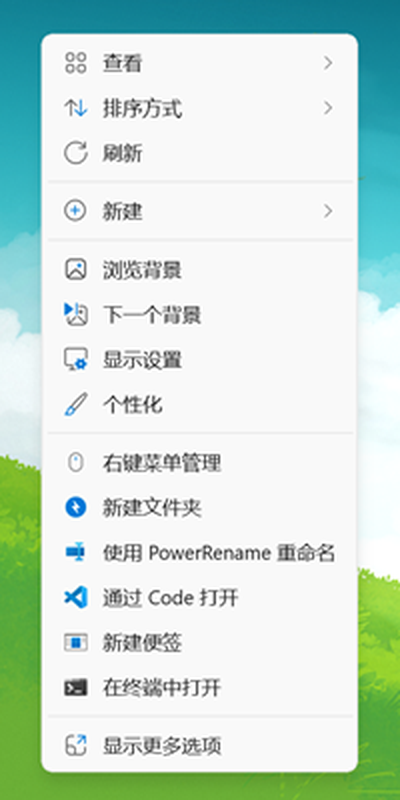
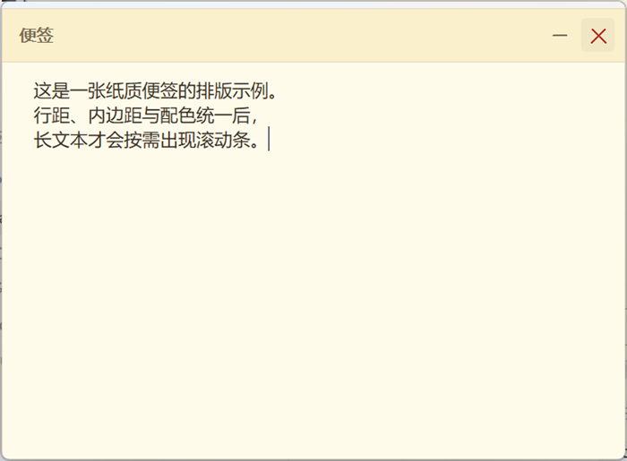
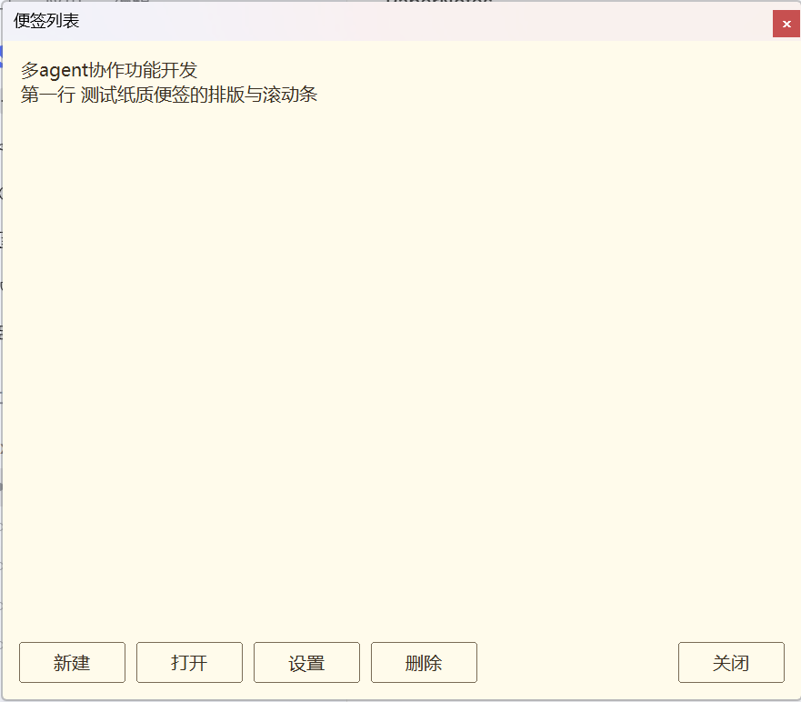

# 纸笺便签 · PaperNotes

[](https://github.com/Cxcoconut/PaperNotes/actions/workflows/build.yml)
[](LICENSE)


在 Windows 11 桌面空白处右键即可新建的便签。便签直接出现在你点右键的地方，是一张张小巧的纸质窗口，关掉不丢、重启还在。

原生 Win32 C++ 写成，单个可执行文件约 250 KB，无 Electron、无 .NET、无安装器框架依赖。



## 它解决什么问题

系统自带的便笺要先进应用再新建，位置也由它决定。这个项目把入口放回你正在操作的地方：**右键 → 新建便签**，便签就落在鼠标处，像真的便利贴一样贴在桌面上。

## 功能

- **右键即建**：Win11 桌面右键的**第一层菜单**里直接有「新建便签」，不需要点「显示更多选项」
- **位置准确**：便签出现在你按下右键的位置，而不是菜单弹出的位置
- **多张并存**：可拖动、可缩放，自动错位避免完全重叠
- **自动保存**：内容与窗口位置、尺寸都会保存，重启后恢复但**保持隐藏**，不打扰
- **两种关闭语义**：标题栏 `−` 隐藏、`×` 删除（删除需二次确认）
- **全局快捷键**：默认 `Ctrl+Alt+N` 新建、`Ctrl+Alt+L` 显示/隐藏列表，可在设置里改，冲突有提示
- **便签列表**：托盘图标不可用时的可靠入口，可打开、删除、进设置
- **纸质界面**：暖墨配色，标题栏按钮用线条绘制，滚动条按需出现
- **DPI 感知**：PerMonitorV2，150% 缩放下布局不塌

<p align="center">
  
  
</p>

## 系统要求

| 项目 | 要求 |
|---|---|
| 系统 | Windows 11（**21H2 / build 22000 及以上**；开发与验证在 build 26200） |
| 架构 | x64 |
| 磁盘 | 约 1 MB（程序）+ 便签数据按实际大小 |
| 权限 | **安装需要管理员**（写入 `Program Files`、注册机器级证书与包） |

> **Windows 10 没有测试过。** 现代第一层菜单依赖 Win11 的 MSIX 菜单扩展，Win10 上只能退到「显示更多选项」里的经典菜单项。

## 快速开始

### 1. 构建

需要 Visual Studio 2022（含 C++ 生成工具）与 Windows SDK 10.0.26100+。

```powershell
# 构建应用与 shell 扩展（会自动停掉正在运行的 PaperNotes，否则 exe 被占用）
powershell -ExecutionPolicy Bypass -File tools\build.ps1 -Action Build
```

产物在 `out\bin\`：`PaperNotes.exe` 与 `PaperNotes.Shell.dll`。

### 2. 安装

**双击仓库根目录的 `install.cmd`**，或：

```powershell
powershell -ExecutionPolicy Bypass -File tools\install.ps1 -Action Install
```

脚本会请求管理员权限，然后依次：复制文件 → 建自签名证书并导入**机器级**受信任根 → 打包签名 MSIX → 注册现代菜单 → 注册经典菜单处理器 → 配置开机自启 → 启动程序（普通权限）。

**安装时会询问安装位置**（提权后的窗口里）：

| 输入 | 结果 |
|---|---|
| 直接回车 | `C:\Program Files\PaperNotes` |
| 完整路径 | 例如 `D:\Apps\PaperNotes` |
| `b` | 打开文件夹选择框 |

也可以跳过询问，直接指定：

```powershell
powershell -ExecutionPolicy Bypass -File tools\install.ps1 -Action Install -InstallDir 'D:\Apps\PaperNotes'
```

路径会被校验：拒绝盘符根目录、Windows 目录、相对路径，以及**已有其他内容的非空目录**（避免把文件混进你的文件夹），并实际写一个探测文件确认可写，避免装到只读位置后中途失败。

> **安装位置影响什么**：经典菜单处理器指向的 DLL、开机自启项、以及你手动启动的 exe 都在所选目录。
> 但 Win11「第一层菜单」由 MSIX 包提供，包体固定在 `C:\Program Files\WindowsApps`，安装位置动不了它。
> 卸载时会自动读回记录的位置，不需要你再指一次。

安装日志：`C:\ProgramData\PaperNotes\install.log`（提权窗口关闭后唯一的线索）。

先看计划不改系统：

```powershell
powershell -ExecutionPolicy Bypass -File tools\install.ps1 -Action Install -DryRun
```

### 3. 卸载

**双击 `uninstall.cmd`**，或：

```powershell
powershell -ExecutionPolicy Bypass -File tools\install.ps1 -Action Uninstall
```

**便签数据默认保留**，在 `%LOCALAPPDATA%\PaperNotes`。

## 使用

| 操作 | 方式 |
|---|---|
| 新建便签 | 桌面右键「新建便签」，或 `Ctrl+Alt+N` |
| 打开便签列表 | `Ctrl+Alt+L`，或托盘图标菜单 |
| 隐藏便签 | 标题栏 `−` |
| 删除便签 | 标题栏 `×`，二次确认 |
| 改快捷键 | 列表窗口 →「设置」 |

## 工作原理

### 两个注册通道，缺一不可

「第一层菜单」是 Win11 的新机制，**只有 MSIX 包能提供**；而一旦桌面被第三方程序（如腾讯桌面整理）接管，它遍历的是注册表里的经典动词，看不到 MSIX 注册。

所以两条通道都注册：

| 通道 | 覆盖场景 | 实现 |
|---|---|---|
| MSIX + `IExplorerCommand` | Win11 原生桌面右键第一层 | `packaging/AppxManifest.xml` |
| 注册表经典动词 / COM 处理器 | 「显示更多选项」、第三方桌面接管 | `HKLM\Software\Classes\...` |

关于「能不能用 `ExplorerCommandHandler` 绕过 MSIX」：**不能**。做过 A/B/C/D 四组对照（移除 MSIX 后分别用注册表动词、COM 处理器、直接调 COM 激活），第一层菜单都不出现，只有「显示更多选项」里有。

### 原始右键位置

现代菜单项被点击时，系统不告诉你用户是在哪里按的右键。所以程序在菜单构建的那一瞬间（`GetTitle` / `GetState` / `QueryContextMenu` 内）用 `GetPhysicalCursorPos()` 采样光标，连同时间戳写入共享内存 `Local\PaperNotes.ClickState.v1`；应用进程读取后按时间窗和连击判定取用。菜单弹出后光标会移动，所以采样必须发生在构建期而不是点击后。

### 存储

一张便签一个文件，纯文本，人可读：

```
x=870
y=481
w=510
h=405

便签正文，UTF-8，可含换行
```

目录按可写性依次回退：`%LOCALAPPDATA%\PaperNotes` → `%USERPROFILE%\PaperNotesData` → `%TEMP%\PaperNotes`。同一时刻只允许一个实例（互斥量 `Local\PaperNotes.SingleInstance.v1`）。

### 界面与尺寸

所有布局常量都是设备无关像素（DIP），统一经 `ScaleFor(dpi, value)` 缩放。便签默认 310×245 DIP，列表 470×400 DIP。

配色只有一处定义，便签、列表、设置三个窗口共用。托盘图标由 `tools/make-icon.py` 生成多尺寸 ICO，其中 16/20px 使用单独的简化画法——把高分辨率细节直接缩到 16px 会糊。

### 安装包为什么是自签名

MSIX 的安装由 AppX 部署服务校验，它只信任**机器级**证书存储（`LocalMachine\Root`），不认 `CurrentUser\Root`。所以安装程序会把自签名证书导入机器级根存储，这也是安装需要管理员权限的原因之一。

对外分发时应当换成受信任 CA 签发的证书，那时不需要用户手动信任。

## 已知限制

- **Windows 10 未测试**，Win10 上只有经典菜单项。
- **第三方桌面接管程序**（如腾讯桌面整理）运行时，现代第一层菜单可能不显示；退出该程序后恢复，或使用经典菜单。
- **需要管理员安装**（自签名证书 + `Program Files`）。
- **验收未完成**：多显示器、不同缩放组合、连续新建压力、空闲内存与延迟指标都还没有系统测过。
- 数据是本地明文，没有加密与同步。
- 便签标题固定为「便签」，不能重命名。

## 项目结构

```
src/App/       便签应用：窗口、绘制、存储、快捷键、列表、设置
src/Shell/     Shell 扩展：IExplorerCommand 与经典 IContextMenu 处理器
src/Common/    两个进程共享的点击状态结构
packaging/     MSIX 清单与图标资源
tools/         构建、安装、注册、验证脚本
docs/evidence/ 验证截图
```

## 开发

不需要安装即可调试菜单：

```powershell
# 每用户注册经典 COM 处理器（免管理员）
powershell -ExecutionPolicy Bypass -File tools\register-shell-handler.ps1

# 只看系统构建出的桌面菜单条目，验证注册是否生效
powershell -ExecutionPolicy Bypass -File tools\probe-shell-menu.ps1

# 端到端验证持久化：新建 → 写文本 → 落盘 → 杀进程 → 重启 → 确认恢复
powershell -ExecutionPolicy Bypass -File tools\verify-persistence.ps1
```

日志：`%LOCALAPPDATA%\PaperNotes\phase0.log`（不可写时退回 `%TEMP%\PaperNotes\phase0.log`）。

> 改 `tools\*.ps1` 时**必须存为 UTF-8 with BOM**。Windows PowerShell 5.1 会把无 BOM 的 UTF-8 当 ANSI 读，中文字面量会变成乱码并导致语法错误。CI 会检查这一条。

> **改了 shell 扩展就必须升 `packaging\AppxManifest.xml` 的版本号。** `PaperNotes.Shell.dll` 是被 Explorer 进程内加载的，文件一直被锁着；即使源码没变，重新构建出的字节也不同（PE 时间戳与调试信息路径），安装程序无法覆盖。版本号决定 DLL 的文件名（`PaperNotes.Shell.<版本>.dll`），升版本号就等于换一个新文件名，天然绕开被加载的旧文件。

> 装完后 `C:\Program Files\PaperNotes\PaperNotes.exe` 与 MSIX 包内那份（`C:\Program Files\WindowsApps\...`）应当**逐字节相同**。桌面第一层菜单启动的是包内那份，自启启动的是 Program Files 那份；两者不同步时会出现「菜单里是旧版本」的怪现象，安装程序会校验并拒绝这种结果。

## 贡献

Issue 和 PR 都欢迎。提 PR 前请确认：

- `tools\build.ps1 -Action Build` 能通过（CI 跑的是同一套构建）
- `tools\*.ps1` 保持 **UTF-8 with BOM**，否则 CI 会直接拦下
- 提交里不要出现 `out\`、证书或私钥（`.gitignore` 已覆盖，别强行 `-f` 加进来）

改动涉及菜单注册、安装程序或存储格式时，请在 PR 描述里写清**验证方式**：做了什么操作、看到什么结果。这个项目踩过几次「看起来通过其实没验证」的坑，所以更看重可复现的验证而不是结论本身。

## 许可证

[MIT](LICENSE)
